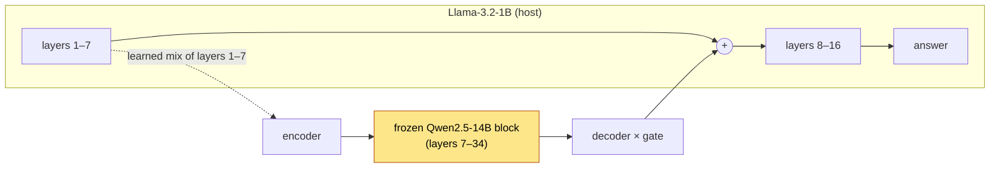

# Sapien: weight-space programming

**Give a small model a bigger model's knowledge by transplanting its layers.**

Sapien wires a frozen block of layers from a big model into a small one,
across model families and tokenizers. It trains only the small connectors
between them. The result is one network: the block's weights are copied
in, and the big model never runs.

<table>
<tr>
<td align="center"><b>MMLU</b><br>44.6 → <b>59.4</b><br><sub>LoRA: 48.0</sub></td>
<td align="center"><b>ARC-Challenge</b><br>52.6 → <b>82.2</b><br><sub>LoRA: 60.0</sub></td>
<td align="center"><b>HellaSwag</b><br>34.6 → <b>65.0</b><br><sub>LoRA: 45.0</sub></td>
<td align="center"><b>vs. LoRA</b><br><b>15 / 15</b><br><sub>benchmarks won</sub></td>
</tr>
</table>

<sub>Llama-3.2-1B with a frozen block from Qwen2.5-14B. None of these benchmarks is trained on.</sub>

## How it works



1. **Pick a donor block.** This is a run of layers from a bigger model,
   such as Qwen2.5-14B or a math or medical specialist. It stays frozen.
2. **Attach it beside the host.** An encoder reads a learned mix of the
   host's layers and maps it into the donor's space. A decoder maps the
   block's output back, and a gate adds it to the host. The gate starts at
   zero, so a freshly attached graft is exactly the original model.
3. **Align.** The encoder learns to give the block inputs that look like
   the donor's own hidden states, so the block computes what it computes
   in its own model.
4. **Integrate.** Only the encoder, decoder and gate train, on
   multiple-choice data from sources that don't overlap the benchmarks
   (`wsp/healdata.py` checks).

LoRA, the fine-tuning baseline, gets the same trainable-parameter budget
and the same data.

## Results

### One graft, 15 benchmarks

Host Llama-3.2-1B, donor Qwen2.5-14B. The graft and LoRA train on the
same mixed-domain data:

| Benchmark | Base | LoRA | Graft | Gain over LoRA |
|---|---|---|---|---|
| MMLU | 44.6 | 48.0 | **59.4** | +11.4 |
| MMLU medical | 52.6 | 52.8 | **65.0** | +12.2 |
| MMLU math | 28.0 | 33.6 | **50.8** | +17.2 |
| MMLU science | 38.2 | 42.0 | **55.2** | +13.2 |
| MMLU computer science | 37.4 | 44.7 | **55.7** | +11.0 |
| MMLU humanities | 53.4 | 56.6 | **71.8** | +15.2 |
| MedMCQA | 41.4 | 41.6 | **47.2** | +5.6 |
| ARC-Challenge | 52.6 | 60.0 | **82.2** | +22.2 |
| ARC-Easy | 73.0 | 75.4 | **91.4** | +16.0 |
| HellaSwag | 34.6 | 45.0 | **65.0** | +20.0 |
| MMLU in Chinese | 40.0 | 38.0 | **49.8** | +11.8 |
| MMLU in Spanish | 37.8 | 38.0 | **52.8** | +14.8 |
| MMLU in Hindi | 31.6 | 35.8 | **39.0** | +3.2 |
| MMLU in Arabic | 37.8 | 35.4 | **42.8** | +7.4 |
| MMLU in Japanese | 36.4 | 35.8 | **43.2** | +7.4 |

The gain comes from the donor's weights. With the donor block's weights
scrambled, the same graft scores 47.4 on MMLU, about the same as LoRA.
With the real weights, a Qwen2.5-7B block scores 53.5.

### Specialist donors win their own domain

Each graft trains on one domain and is scored on it:

| Domain | Donor | Base | LoRA | Graft |
|---|---|---|---|---|
| Math (AQuA) | Qwen2.5-Math-7B | 25.5 | 34.5 | **52.0** |
| Medicine (HeadQA) | Apollo2-7B | 45.8 | 51.7 | **54.8** |
| Medicine (MedMCQA, unseen) | Apollo2-7B | 41.4 | 39.7 | **45.1** |
| Science (SciQ) | Qwen2.5-7B | 85.8 | 87.5 | **89.8** |
| MMLU | Qwen2.5-7B | 44.6 | 47.1 | **53.1** |

### Every donor beats LoRA, and bigger donors give more

MMLU held-out, host Llama-3.2-1B, same mixed training data. LoRA scores
48.0:

| Donor | Kind | MMLU |
|---|---|---|
| Qwen2.5-14B | general | **59.4** |
| Apollo2-7B | medical | 53.8 |
| Qwen3-8B | general (newer generation) | 53.7 |
| Qwen2.5-7B | general | 53.5 |
| Qwen2.5-Coder-7B | code | 53.1 |
| Qwen2.5-Math-7B | math | 50.5 |

| Host | Base | LoRA | 7B donor | 14B donor | 32B donor |
|---|---|---|---|---|---|
| Llama-3.2-1B | 44.6 | 46.0 | 53.6 | 59.8 | **62.6** |
| Llama-3.2-3B | 57.4 | 60.7 | — | 66.0 | **66.3** |

The full log of experiments is in
[docs/research/2026-11-15-parallel-graft.md](docs/research/2026-11-15-parallel-graft.md).

## Try it

The compiler plans the graft from a plain request: a host, a skill and a
donor. `--plan-only` prints the plan on your machine and starts nothing:

```bash
.venv/bin/modal run modal_sapien.py --request demo/requests/xfam_knowledge14.json --plan-only
```

```
pgraft (seam)  per token 9.244B
  write Qwen/Qwen2.5-14B-Instruct into the host as one network. Host layer 7
  donor span layers 6..34 of 48 (29 layers, 7.983B parameters, frozen)
  Enc depth 2 (2048 to 5120, 23.60M)  Dec rank 256 (1.84M)  per-token gate (2049)  host LoRA rank 16 (11.27M)
  Enc reads a learned mix of host layers 1..7 (each RMS-normed), not host layer 7 alone
```

Drop `--plan-only` to compile it on a GPU. The compiled model and its
report land on the Modal volume under `/vol/sapien/<name>`, and the scores
go to `results/sapien_<name>.json`. The compiler also trains two controls
(no donor block, and scrambled donor weights) and reports them beside the
result.

The compiler's recipe differs from the experiments above in one way: it
trains on benchmark *train* splits (such as MMLU auxiliary_train), with
every evaluation prompt removed, and scores on held-out test items.

CPU tests (tiny models, no downloads):

```bash
uv venv --python 3.12 && uv pip install -e ".[dev]" && .venv/bin/pytest -q
```

## Where things are

- `wsp/pgraft.py`: the graft (encoder, donor block, decoder, gate),
  alignment and training.
- `wsp/auto.py`, `wsp/pgraft_stage.py`, `wsp/xfam.py`: the compiler's
  graft method, from request to a saved model that reloads exactly.
- `modal_hill.py`: the experiments behind the results above.
  `modal_sapien.py`: runs a request end to end.
- `wsp/healdata.py`: training data sources and the leak check.
- `wsp/`: the Sapien language and compiler. See
  [docs/quickstart.md](docs/quickstart.md) and
  [docs/language.md](docs/language.md).
- `wsp_eval/`: the eval harness. `studio/`: the web app. `library/`: the
  parts library.
