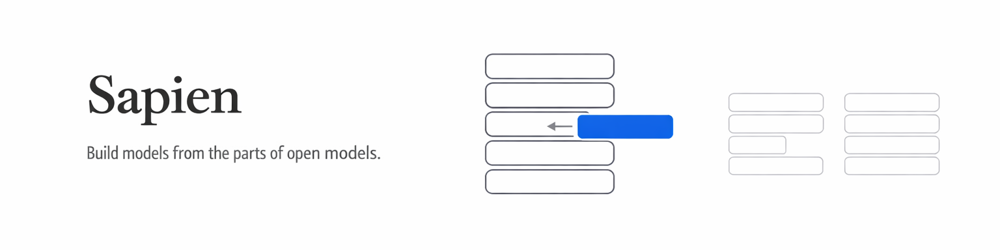
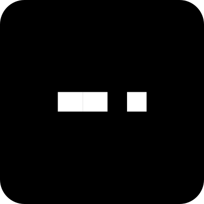
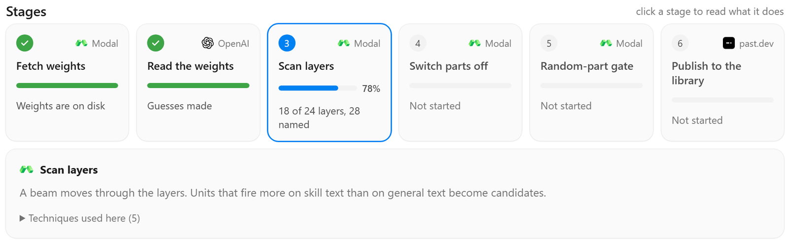
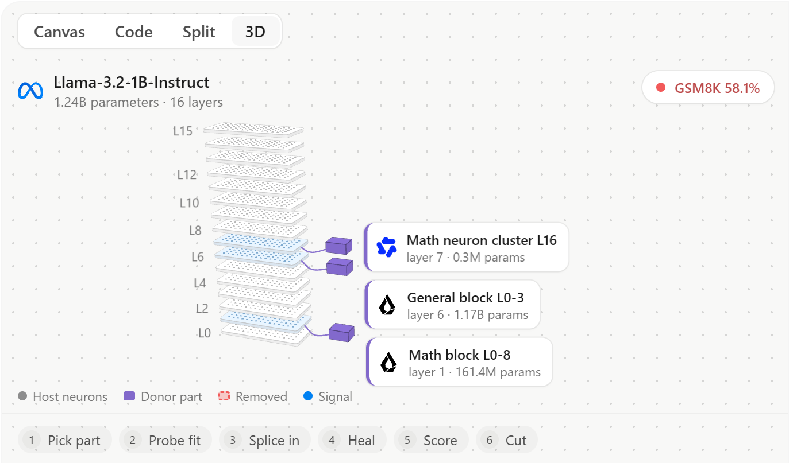
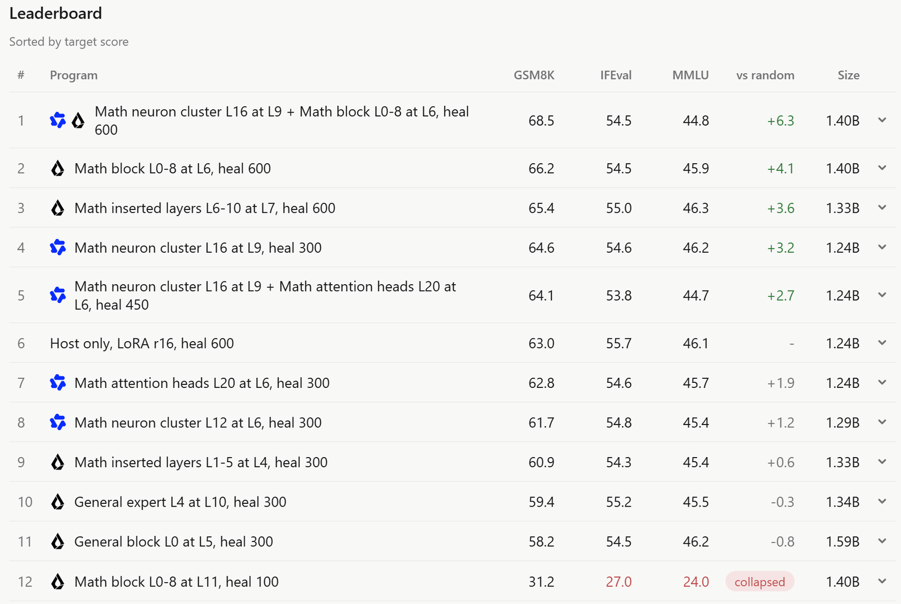
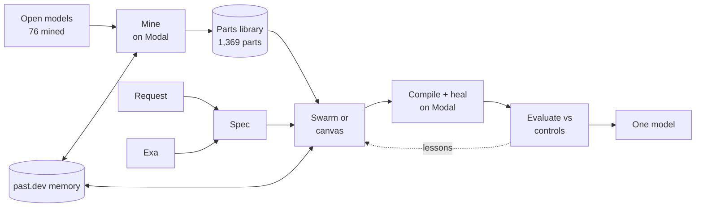
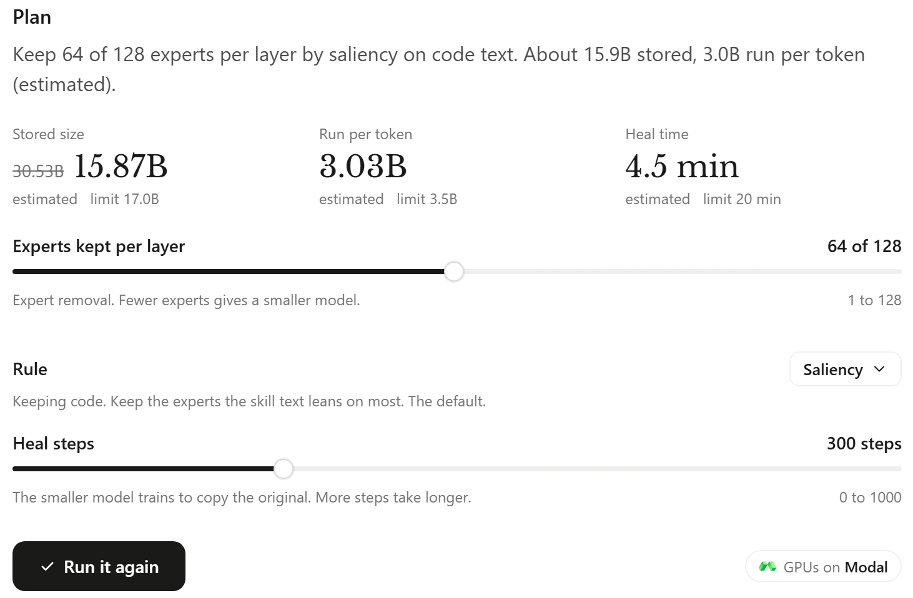

<picture>
  <source media="(prefers-color-scheme: dark)" srcset="docs/img/banner-dark.png">
  
</picture>

Sapien builds custom models from the parts of existing open models. Agents read the weights of open models and file the pieces that hold a skill into a parts library. A compiler then joins those parts into a base model, or cuts a large model down to the parts one skill needs, and trains only small connectors at the seams. Grafting a slice of Qwen2.5-14B into Llama-3.2-1B lifts its MMLU score from 44.6 to 59.8, where fine-tuning with the same trainable budget reaches 45.6. Cutting Qwen3-30B-A3B to half its experts keeps its HumanEval score within 4 points at half the memory.

Built at the SF AI Research Hackathon, hosted by Iterate at Wefunder, San Francisco, 14 to 15 November 2026.

| <a href="https://exa.ai"></a> | <a href="https://past.dev"></a> | <a href="https://modal.com"></a> |
|:---:|:---:|:---:|
| **Exa**: benchmark research and literature priors | **past.dev**: shared memory for every agent | **Modal**: all mining, compiling and serving |

### Results at a glance

| Result | Slice grafted | Number |
|---|---|---|
| Llama-3.2-1B + grafted slice, MMLU held-out | Qwen2.5-14B L7-34 | **59.8** (base 44.6, LoRA 45.6) |
| Math graft on AQuA, Llama-3.2-1B host | Qwen2.5-Math-7B L4-20 | **52.0** (LoRA 34.5) |
| MMLU in Spanish after English-only training, Llama-3.2-1B host | Qwen2.5-14B L7-34 | **52.8** (base 37.8, LoRA 38.0) |
| Cross-family part, share of its own skill kept inside Llama-3.2-1B | Qwen2.5-7B L10-20 | **89.6%** (1.1% before alignment) |
| Qwen3-30B-A3B cut to 64 of 128 experts: HumanEval, weight memory | none (experts removed) | **88.4** at **29.9 GiB** (full: 90.2 at 56.9 GiB) |
| Parts mined | | **1,369** from **76** models, 0.35B to 235B |
| Shared memories written by the agents on past.dev | | **42,338** |

## Motivation

Fine-tuning changes every weight of one model to teach it a skill that some other open model already has. Thousands of open-weight models exist, and each one stores its skills in units you can find: specific MoE experts handle code tokens, specific layers carry factual recall, specific heads move information across positions. Building on the research of Weight-Space Programming, ([Sparks of Weight-Space Programming, 2026](https://rikiyat.github.io/blog/weight-space-programming/)), Sapien hopes to create a 'parts' resource for open models at scale: agents read the weights of open models, file the units that hold a skill into a parts library, and write new models as programs over those parts.

## Questions we explored
1. **Grafting.** Can a slice of a large model, added to a small one, make the small model better than fine-tuning it?
2. **Mining.** Can agents find parts that hold a measurable skill in any model, at any size, with controls that rule out noise?
3. **Compiling.** Can parts from a different model family, with a different tokenizer, run inside a host and keep working?
4. **Shrinking.** Can a frontier model compress an open-source model by reading its weights: find the parts that hold one skill, delete the rest, and keep that skill at a fraction of the size?

## What it does

Sapien turns a plain-language request ("a coding model at half the memory", "a 2B model that reads contracts") into one model built from the parts of existing models.

1. **Mine.** Agents read the weights of open models and name the parts that hold a skill. So far: 1,369 parts from 76 models (0.35B to 235B), with 42,338 shared memories on past.dev.
2. **Test.** Each part is switched off and every skill rescored. It is kept only if its own skill drops at least 15% on held-out text and more than for five random parts of the same size.
3. **Plan.** Sapien drafts a "Frankenstein" model for the task: a base plus parts, under limits on size, compute per token and heal time. An Exa agent picks the benchmarks to target.

<table><tr>
<td width="50%"><br><sub>Mining a model, stage by stage</sub></td>
<td width="50%"><br><sub>Exa finds the benchmarks for a request</sub></td>
</tr></table>

4. **Compile.** A swarm of agents, or a person on a canvas, places the parts; each result steers the next choice (for example, a Qwen2.5-7B slice only helps once it runs past layer 15).
5. **Heal.** A short training pass fits the parts in. Only the connectors train, about 14M parameters for a 7B donor slice.
6. **Evaluate.** Every build is scored on a held-out split against the base, a LoRA of the same trainable size, the connector alone, and random parts of the same size.

<table><tr>
<td width="50%"><br><sub>Parts placed on Llama-3.2-1B</sub></td>
<td width="50%"><br><sub>Every build ranked against the controls</sub></td>
</tr></table>

The output is one standard model that loads in Hugging Face Transformers and serves on vLLM.

## Architecture



## Results

### 1. Grafting beats fine-tuning

A frozen slice of a larger model, grafted into a small host, beats every fine-tuning arm on every benchmark we ran.

- **Slice grafted:** the donor model and the layers taken from it.
- **Base:** the host model untouched.
- **LoRA / Full FT:** the host fine-tuned on the same data as the graft.
- **Adapter / Scrambled:** the graft's connectors with the donor removed, or with its weights shuffled.
- **Graft:** the host with the donor slice and its connectors.

**Domain grafts** (Llama-3.2-1B host, trained on each domain)

| Domain | Slice grafted | Base | LoRA | Adapter | Graft |
|---|---|---|---|---|---|
| AQuA | Qwen2.5-Math-7B L4-20 | 25.5 | 34.5 | 39.0 | **52.0** |
| HEAD-QA | Apollo2-7B L4-20 | 45.8 | 51.7 | 42.8 | **54.8** |
| MedMCQA | Apollo2-7B L4-20 | 41.4 | 39.7 | 37.8 | **45.1** |
| SciQ | Qwen2.5-7B L4-20 | 85.8 | 87.5 | 88.2 | **89.8** |
| MMLU | Qwen2.5-7B L4-20 | 44.6 | 47.1 | 45.6 | **53.1** |

**One general graft** (Llama-3.2-1B host, trained on English only)

| Benchmark | Slice grafted | Base | LoRA | Graft |
|---|---|---|---|---|
| MMLU | Qwen2.5-14B L7-34 | 44.6 | 48.0 | **59.4** |
| ARC-Challenge | Qwen2.5-14B L7-34 | 52.6 | 60.0 | **82.2** |
| HellaSwag | Qwen2.5-14B L7-34 | 34.6 | 45.0 | **65.0** |
| MMLU math | Qwen2.5-14B L7-34 | 28.0 | 33.6 | **50.8** |
| MMLU Spanish | Qwen2.5-14B L7-34 | 37.8 | 38.0 | **52.8** |
| MMLU Chinese | Qwen2.5-14B L7-34 | 40.0 | 38.0 | **49.8** |

**Against a full fine-tune** (same data, steps and selection for every arm; mean over 2 to 3 seeds)

| Host + slice grafted | Benchmark | Base | Full FT | LoRA | Scrambled | Graft |
|---|---|---|---|---|---|---|
| Llama-3.2-1B + Qwen2.5-7B L4-20 | MMLU | 44.6 | 51.1 | 50.0 | 50.3 | **59.6** |
| Qwen2.5-1.5B + Qwen2.5-14B L14-47 | MMLU | 60.4 | 60.8 | 61.9 | 60.8 | **65.9** |
| Qwen2.5-1.5B + Qwen2.5-Math-7B L4-20 | GSM8K | 73.6 | 70.4 | 73.5 | 73.2 | **84.8** |

- **The graft carries the donor's languages.** Trained only on English, it lifts MMLU Spanish by 15 points and Chinese by 10; LoRA on the same data moves neither.
- **The gain is the donor's knowledge.** Scrambled donor weights score at the fine-tuning level, and a full fine-tune of every host weight trails the graft by 8.5 MMLU points and 14 GSM8K points.
- **Bigger donors give more.** On the 1B host, a 7B slice adds 8 to 10 MMLU points, a 14B slice 15, a 32B slice 18.
- **The cost is compute per token.** Llama-1B with a 7B slice runs 5.2B parameters per token, so the next test is a host that is already the best at that size.

### 2. Mining: from toy skills to domain skills

Agents mined progressively harder skills. They started with toy skills small enough to check exactly: Roman numerals, compass directions, the next month or weekday. Switching off one MLP cluster in layer 25 of LFM2.5-2.6B, for example, cut its Roman-numeral score by 0.372 while its control moved by 0.001.

Every attempt, pass or fail, went to past.dev, so each agent built on what the others had found. Once agents recalled before writing a new test, each recall returned 11 to 14 relevant records; the agent mining Phi-4 found a teammate's integer-parity test before writing its own. From there the agents moved on to domain skills: math, science, medicine, law, code and languages.

The library now holds parts for:

| Skill area | Parts |
|---|---|
| Math (including grade-school arithmetic) | 659 |
| Programming languages (Java, Rust, C#, TypeScript, PHP, Swift, C++, SQL, shell and more) | 17 to 20 each |
| Science and professional subjects (chemistry, physics, biology, medicine, clinical knowledge, law, finance) | 17 to 21 each |
| Natural languages (Chinese, Hindi, Russian, French, Japanese, Arabic, Spanish) | 18 to 20 each |
| Tool calling and instruction following | 19 to 20 each |

Qwen2.5-Math-7B alone gave 63 math parts. Gemma-4-26B-A4B gave expert sets that each write output in one language (Russian, German, Chinese, French, Italian, Japanese, Spanish) in layers 20 to 29. In all, 1,606 library entries cover 76 models from 0.35B to 235B parameters.

### 3. Compiling: a part from another model family keeps 90% of its skill inside the host

The hard part of grafting is translation. The host and donor come from different companies, use different tokenizers, and represent text in different hidden spaces, so a donor slice fed the host's raw states produces noise. The compiler fixes this in three steps.

1. **Align.** A small encoder learns to turn the host's hidden states into the states the donor slice expects. It trains by making the donor's next-token predictions on host states match the donor's own predictions on the same text, with positions paired across the two tokenizers by character offsets. Before alignment, Qwen2.5-7B keeps 1.1% of its next-token accuracy when it runs on Llama's states. After 600 training steps (about 2 minutes on an H100) it keeps 89.6%.
2. **Glue.** A decoder reads what the donor slice changed and writes it back into the host, and a per-token gate decides how much to let through. Both start at zero, so the network starts as the exact host. The gate learns to open on domain text (an update of 0.12 to 0.35 times the hidden state's size) and stay nearly shut on general text (0.02 to 0.04).
3. **Heal.** A short training pass on answer letters teaches the host to use the new branch, with a penalty for drifting from the original host. On law text, which no graft trains on, the grafted model drifts less from the base than LoRA does (KL 0.01 against 0.03 to 0.06).

When donor and host share a tokenizer, the connector is close to lossless: a Qwen donor block inside a Qwen base computes what it computes in its own model, at a cost of 0.008 nats.

### 4. Shrinking: removing experts keeps one skill and drops the rest

Qwen3-30B-A3B has 128 experts in each layer. Each layer keeps its top N experts by code saliency: how strongly the router picks an expert on code text, times how much that expert changes the output. The text used to rank and heal is code instructions, never benchmark items.

| Model | Total params | HumanEval | MBPP | MMLU |
|---|---|---|---|---|
| Full Qwen3-30B-A3B | 30.5B | 91.5 | 84.4 | 77.8 |
| Keep 64 experts by code saliency, no training | 16.0B | 87.8 | 79.0 | 44.9 |
| Keep 32 by code saliency, healed | 8.78B | 73.8 | 61.9 | 25.6 |
| Keep 32 random experts, healed (3 seeds) | 8.78B | 6.1 to 11.6 | 7.4 to 23.3 | 24 |



<sub>A shrink plan: keep 64 of 128 experts per layer, ranked by code saliency.</sub>

Half the experts keep HumanEval within 4 points with no training, while MMLU falls 33 points: the other skills leave with the deleted experts. Random experts of the same count lose code entirely, so the choice of experts carries the skill.

Served on vLLM 0.32 on one H200, the 64-expert model halves weight memory, solves 145 of the 148 HumanEval items the full model solves, and decodes 21% faster at batch 32:

| Model | vLLM weight memory | HumanEval (164) | Decode tok/s, batch 1 / 32 |
|---|---|---|---|
| Full Qwen3-30B-A3B | 56.93 GiB | 90.2 | 259 / 2486 |
| Keep 64 experts | 29.92 GiB | 88.4 | 259 / 3021 |

The same ranking keeps whichever skill the request names. For a clinic ("a private assistant that answers medical questions as well as Qwen3-30B, on a smaller GPU we can keep on site") the experts are ranked on medical text. For a law firm they are ranked on legal text. No training in either case, one run each ([demo/README.md](demo/README.md)):

| Request | Model | Total params | Skill score | MMLU general |
|---|---|---|---|---|
| Clinic | Full Qwen3-30B-A3B | 30.5B | MedMCQA 68.0, MMLU medical 86.9 | 77.2 |
| Clinic | Keep 64 experts by medical saliency | 16.0B | MedMCQA 65.9, MMLU medical 84.3 | 65.0 |
| Clinic | Keep 48 by medical saliency | 12.4B | MedMCQA 64.5, MMLU medical 81.3 | 56.8 |
| Clinic | Keep 48 random experts | 12.4B | MedMCQA 31.1, MMLU medical 21.7 | 23.8 |
| Law firm | Full Qwen3-30B-A3B | 30.5B | MMLU law 62.7 | 80.3 |
| Law firm | Keep 64 experts by legal saliency | 16.0B | MMLU law 61.8 | 60.3 |
| Law firm | Keep 48 random experts | 12.4B | MMLU law 24.4 | 24.4 |

At half the size the clinic model loses 2.1 points on MedMCQA and 2.5 on MMLU medical, and the law model loses 0.9 on MMLU law, while general MMLU falls 12 and 20 points. One model gives a code model, a medical model, or a law model depending on which experts the request keeps, and the random control at the same size falls to chance each time.

The result is a standard checkpoint, so quantization and speculative decoding apply to it as to any model; those numbers are in [docs/efficiency.md](docs/efficiency.md) and are not part of Sapien's method.

Verified self-training lifts the 32-expert model. One round samples 10,594 train problems with tests (MBPP train, validation and prompt splits, LeetCodeDataset, APPS and AceCode-87K, with any problem that shares a 13-gram with a HumanEval or MBPP test item dropped), keeps the answers that pass their tests, adds passing answers from the full 30B model, and trains on them. Under vLLM it moves the healed 8.78B model from 82.9 to 83.5 on HumanEval and from 73.2 to 77.0 on MBPP, against 90.9 and 83.7 for the full model in the same harness (one seed; the HumanEval change is inside the noise) ([docs/rft.md](docs/rft.md)).

The same method works at 235B. On Qwen3-235B-A22B-Instruct-2507 (8 H200s, no training), keeping 64 of 128 experts cuts the model from 235.1B to 121.5B parameters and scores 92.7 HumanEval and 87.2 MBPP, against 93.3 and 87.5 for the full model ([docs/moonshot.md](docs/moonshot.md)).

## How we built it

### Mining

Code: `person_a/mine/`. For one donor model, a mining agent (Claude Opus 5.5 or GPT-5 through a tool loop, `agent.py`) does four things:

1. Reads the raw weights in a network-blocked, read-only Modal sandbox (`weight_sandbox.py`).
2. Proposes open-vocabulary skill labels (Roman numerals, month successor, per-language output experts).
3. Writes frozen tests for each label, with a matched control text and a chance check (`skills.py`).
4. Screens candidate parts by zero-ablation on a Modal GPU. Every ablation scores all active skills in one teacher-forced pass, as the mean log-prob of the answer tokens.

`adapter.py` installs one zero-ablation hook per part kind: zero the MLP down-projection columns, zero a head's slice of the attention out-projection (also Gated DeltaNet layers), set banned experts' routing weights to 0 at the fused-experts input, or replace a layer's output with its input.

A part passes the light gate (`gate_version` 2) only if:

- the target skill drops at least 15% relative on both the search half and a held-out half the agent sees only as pass or fail;
- every other skill drops by at most max(5%, target drop / 3);
- the target's matched control moves by at most the same limit in either direction;
- the target drop beats each of 5 random parts of the same size and kind in the same layer.

`sweep.py` ranks every unit of every layer by attribution with no LLM in the loop, and `maps.py` builds model-level skill maps (layer scores, blocks, expert pick rates). The Qwen3-30B-A3B map covers 48 layers and 38 skills with a median split-half correlation of 0.98.

The library now holds 584 expert sets, 430 MLP clusters, 264 blocks, 91 head groups, 58 measured stitch recipes, 37 deletion masks, 44 findings and 23 run recipes across 76 models from 0.35B to 235B parameters (Qwen, Llama, Gemma, LFM, Phi, Granite and domain fine-tunes).

### Compiler

Code: `wsp/`. Before building anything, the compiler works out how each source model relates to the base: identical, a fine-tune of the same base, the same tokenizer, or a different family (`wsp/lineage.py`). It decides this from small reads of each model's config, tokenizer and a few weight slices, with no full download. The relation sets which build methods are allowed, and the planner (`wsp/auto.py`) takes the first one that fits the size limits.

A part from another model joins the base as a side branch at a chosen layer. A small connector maps the base model's hidden state into the part's space and back, and starts at zero, so a fresh part changes nothing until training. Parts keep their own attention cache, so generation with a cache gives the same output as without. Two fixes made cross-model parts work at all: feeding each part the state its own model expects at the first token (its attention sink), and scaling inputs to the size the part saw in its own model.

`wsp/slim.py` removes experts, layers, neurons or heads and runs the distillation heal. `sapien check` estimates the finished size against the limits before any GPU starts.

### Swarm and studio

Code: `wsp/swarm/` and `studio/`. The swarm is an RL-style environment: planner agents propose programs over the library, a judge ranks them each round, and an analyst keeps a capability map. Each evaluation charges a fixed budget, and baselines (evolutionary search, LoRA, full fine-tune) run at the same budget. `wsp/swarm/program_schema.py` validates every proposal before it costs an eval.

The Sapien studio is a FastAPI app over the compiler and swarm. A person describes a model in plain language, the studio drafts a spec, a research agent proposes benchmarks with sourced reference scores, and then either the swarm builds the model or the person places parts on a canvas. On the Modal backend each call compiles one program, trains its stitch and heal, scores it, and returns per-component verdicts in one GPU container.

## Sponsor challenges

###  Exa: research agents that search

Exa runs in two loops.

**Benchmark research** (`studio/server/bench_research.py`, lines 672 and 1029). Every spec draft starts a research agent that plans searches, picks 3 to 6 benchmarks that fit the request, then searches each benchmark's published results and extracts reference scores for models within the size limit. A checker opens each cited page with Exa get-contents and keeps a score only when the number appears on the page for that benchmark and that model. The spec page shows every query, source URL and quote.

We graded it on 8 requests (legal, coding, nursing, math tutoring, telecom support, English-Spanish, a coding-only shrink, general reasoning) by opening every source page by hand ([docs/research/bench_research_eval.md](docs/research/bench_research_eval.md)). Before the fixes, 29 of 59 checked scores (49%) were fully right; the common failures were the right number from the wrong column or the wrong model. After the fixes, 24 of 24 sourced scores were right. The agent picked domain benchmarks a model would not list from memory, such as tau-bench telecom and CaseHOLD.

**Literature priors for the swarm** (`wsp/swarm/literature.py`). Planners read Exa search results as priors before proposing programs. Every call goes through one module with a content-addressed cache: the key is the sha256 of the endpoint, SDK version and exact parameters, and the cache is git-tracked in `exa_cache/` so graded runs replay with zero network calls. A second cache tier on a `modal.Dict` lets parallel containers share hits. Queries are capped at 400 characters, dataset mirror domains are excluded, the published-date filter is pinned, and Exa never sees held-out data or touches the eval budget.

###  past.dev: shared memory for agent swarms

past.dev is the team's shared memory and the swarm's memory, under two separate scoping rules.

**Team memory** (`person_a/mine/shared_memory.py`, `scripts/team_memory.py`). Every person and every coding agent on the team recalls before a task and records after each decision or result, in the audience `wsp-mining`. Mining agents write each part attempt, gate verdict and failure, so an agent mining Gemma reads what another agent found in Qwen. The client refuses writes outside that audience.

**Run-scoped swarm memory** (`wsp/swarm/memory.py`). A benchmark run must read only what it wrote, or the eval budget comparison is unfair. Each run gets fixed audiences (`<run>-lessons` for planners, judge and analyst; `<run>-judge` for the judge alone) and per-run identities. Before the first step, a cold-start guard recalls as a planner with a generic query and requires zero results, which proves no project-level leakage. Ids embed the run id, and at the end of the run all data points are deleted in batches of up to 1,000 and the audiences removed. Records are one self-contained sentence with the score in it, for example a collapse lesson: which deletion dropped instruction following from 0.61 to 0.02. The planned ablation is the same swarm with `PAST_ENABLED=false` at equal eval budget.

An audit of Rex's mining runs (qwen3.8_27b, gemma4_31b, phi4_14b) found every write landed with no dropped batches, but the agents made 0 `recall_shared` calls during runs: they read team memory once at startup, with a query that named the architecture and not the model, and about 2 in 3 attempt records were ablation-only probes that crowded recalls. That finding changed how the agent queries memory.

###  Modal: training, inference and large-scale experiments

Every GPU step runs on Modal: mining, compiling, healing, scoring and serving.

- **Mining engine** (`person_a/mine/engine_app.py`). Deployed classes `EngineL4` through `EngineB200x8`, one per GPU tier, share one `EngineBase`. The client picks the tier from model size. Weights live on a shared volume at a pinned snapshot, and the agent's weight-reading sandbox has no network access.
- **Parallel mining**. Twelve Claude Opus 5.5 mining agents ran at once across three Modal workspaces on the first night, alongside skill-map jobs for Qwen2.5-32B, Qwen3-30B-A3B and Qwen3.5-35B-A3B, until all three workspaces hit the 10-container GPU limit and mining paused for the compiler's rounds.
- **Compiler rounds** (`modal_round*.py`, 28 rounds). Each round sweeps cells with seeds and controls in parallel containers. Run 2 alone was 72 cells.
- **Studio backend** (`studio/modal_studio.py`). The `wsp-studio` app compiles, heals and scores one program per call on L40S, or H100 when a donor is above about 10B parameters.
- **Serving** (`modal_serve.py`). vLLM 0.32 on H200 measures weight memory, decode and prefill throughput and time to first token for each slimmed model, and the 235B run used 8 H200s.

## Track 1: autoresearch

Sapien runs the research loop on model construction. A mining agent picks a hypothesis about a donor (a label and a layer), writes a frozen test, runs the ablation on Modal, reads the gate result against random controls, records it to past.dev, and picks the next hypothesis. The swarm does the same over programs: propose, compile, score at a fixed eval budget, rank, record lessons, propose again.

The record Sapien targets is the best existing open model at the same size. That bar is in every comparison table above, and the compiler's latest change checks each graft plan against it before spending GPU time. The 1B host with a grafted 14B slice reaches 59.8 on MMLU held-out (three-seed mean), against 45.6 for fine-tuning the same host.

Each decision is logged: `experiments.jsonl` for swarm steps, `results/README.md` for every run with its controls and reading, `library/index.jsonl` with `added_by`, `source` and evidence on every entry, and the past.dev audiences for the reasoning between steps.

## Challenges we ran into

- **Mining takes time.** Users will ask for models in many domains: legal, literature, biology, medicine. Each domain needs its donor models mined and its parts tested before anything can be compiled from them. The skill map of Qwen3-30B-A3B alone took 1,352 GPU-seconds, every candidate part then needs an ablation pass plus five random-part controls, and our mining agents ran with 3-hour caps. Over the weekend twelve agents ran in parallel across three Modal workspaces until all three hit their 10-container GPU limit, and the library still covers 76 models. Mining has to run ahead of demand, so the parts already exist when a request arrives.
- **Models are built differently.** A donor and a host rarely match. Llama-3.2-1B has 16 layers and a 2,048-wide hidden state; Qwen2.5-7B has 28 layers and a 3,584-wide one. They split text into different tokens, use different numbers of attention heads, scale their hidden states differently, and park attention on the first token in different ways. Some models route tokens to MoE experts and some (Liquid's LFM) mix in convolution or linear-attention layers. A donor slice fed the host's raw states keeps 1.1% of its own accuracy. The compiler bridges this with a learned encoder and decoder between the two hidden sizes, positions matched across tokenizers by character offsets, the donor's own first-token state fed at position 0, and inputs rescaled to the size the donor expects. That brings the donor back to 89.6%.
- **Choosing benchmarks.** At first we picked benchmarks by hand, and the right ones for a request were hard to find: domains do not map neatly to benchmarks. A telecom support model needs tau-bench's telecom split; a legal helper needs LegalBench and CaseHOLD. Exa turned out to be good at scanning the web for the benchmarks that fit a request and the published scores to compare against. The first version still pulled the wrong number from a results table half the time (29 of 59 checked scores fully right), so we added a checker that opens every cited page and keeps a score only when it appears there for that benchmark and that model: 24 of 24 after the fix.
- **Domains with no right answer.** Sapien's mining gate and its evaluations both need an answer that can be checked: a multiple-choice letter, a unit test, a final number. Creative writing has none. The closest signals are likelihood on held-out text or a judge model's opinion, and neither shows that the writing got better. A request like "a model that is great at creative writing" is the hardest one Sapien gets, and we do not yet have a score for it we would stand behind.

## What's next

- **Mine more parts.** Keep mining open models and grow the library, so more requests can be built from parts that already exist.
- **Test for superadditive composition.** Measure whether combining certain parts gives more than the sum of their separate gains (a non-additive interaction), or less. Two specialists in one 1B host already reach 55.4 MMLU held-out against 53.9 for one; we want the interaction measured across many pairs of experts and blocks, with each part's solo gain as the baseline.
- **Measure cost against fine-tuning.** Grafting trains about 14M connector parameters while the donor stays frozen. We will measure GPU time and dollars per point gained against LoRA and full fine-tuning on the same tasks, to test whether building from parts is a faster, more modular way to make fine-tuned models, and whether it can feed into frontier-scale training.
- **Test the shrunk models more.** Run the 64-expert Qwen3-30B-A3B and the 235B cuts on more code benchmarks and seeds, heal them for the planned 30 minutes, and tune vLLM's MoE kernels for 64 experts, since the cut 30B model prefills 38% slower than the full one under the default settings.

## Team

- **Trisanth** built the compiler and set the research direction.
- **Hanav** built the parts-mining pipeline.
- **Arjun** built and improved the swarm environment.
- **Rex** built the evals and the Exa and past.dev integrations, and ran mining on Qwen, Gemma and Phi models.

## Repository layout

| Folder | What it holds |
|---|---|
| `wsp/` | The Sapien language, compiler, planner (`auto.py`), expert removal (`slim.py`) and the `sapien` CLI |
| `wsp/swarm/` | The agent swarm: planners, judge, budget, baselines, Exa priors, past.dev memory |
| `wsp_eval/` | Evaluation harness and extraction tools |
| `person_a/mine/` | The mining pipeline: Modal engine tiers, ablation hooks, the gate, the mining agents |
| `library/`, `atlas/`, `parts_extracted/` | The parts library, per-model skill maps and extracted part tensors |
| `studio/` | The Sapien studio web app (FastAPI server and browser front end) |
| `composer/` | The agent that writes a Sapien program from a request |
| `modal_*.py` | Every Modal entry point: the pipeline (`modal_sapien.py`, `modal_serve.py`, `modal_swarm.py`) and each experiment round |
| `results/` | The results log and raw rows for every run |
| `docs/` | Design docs, research notes and the full reference |
| `demo/`, `requests/`, `sapien_requests/` | Example requests and the demo plans |
| `scripts/`, `tests/` | Utilities and the CPU test suite |

## Run it

The full language and compiler reference (every graft option, the mask format, Modal profiles) is in [docs/wsp-reference.md](docs/wsp-reference.md).

CPU tests (toy tensors, no model downloads):

```bash
uv venv --python 3.12 && uv pip install -e ".[dev]" && .venv/bin/pytest -q
```

Plan a request with no GPU and no weights, then build it:

```bash
sapien plan demo/requests/code_half_memory.json
modal run modal_sapien.py --request demo/requests/code_half_memory.json
```

Write and compile a program directly:

```bash
sapien check prog.sap
sapien compile prog.sap -o out
sapien compile prog.sap -o ctl --control random
sapien score out --skills humaneval,mbpp,mmlu
```

Studio (stub backend, or `WSP_STUDIO_BACKEND=modal` after `modal deploy studio/modal_studio.py`):

```bash
pip install -e ".[dev,swarm,studio]" && uvicorn studio.server.app:app --port 8765
```

`EXA_API_KEY`, `PAST_API_KEY`, `OPENAI_API_KEY` or `ANTHROPIC_API_KEY`, and Modal tokens are read from `.env`.

## Built with

Python, PyTorch, Hugging Face Transformers 5, safetensors, vLLM, Modal, Exa (`exa-py`), past.dev, FastAPI, Claude Opus 5.5, GPT-5, LoRA, Deletion Tuning masks, and open-weight models from Qwen, Meta Llama, Google Gemma, Liquid AI, Microsoft Phi and IBM Granite.

## License

Deletion Tuning mask code is from agentic-learning-ai-lab/deleting-weights (MIT). Each mined part keeps the license of its source model, recorded in its library profile.
