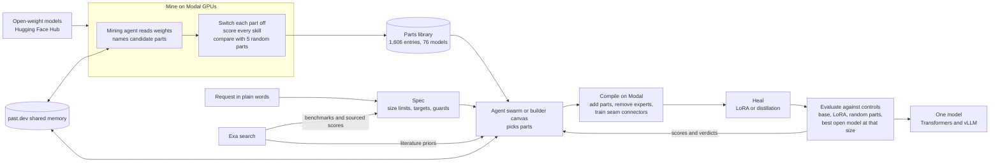
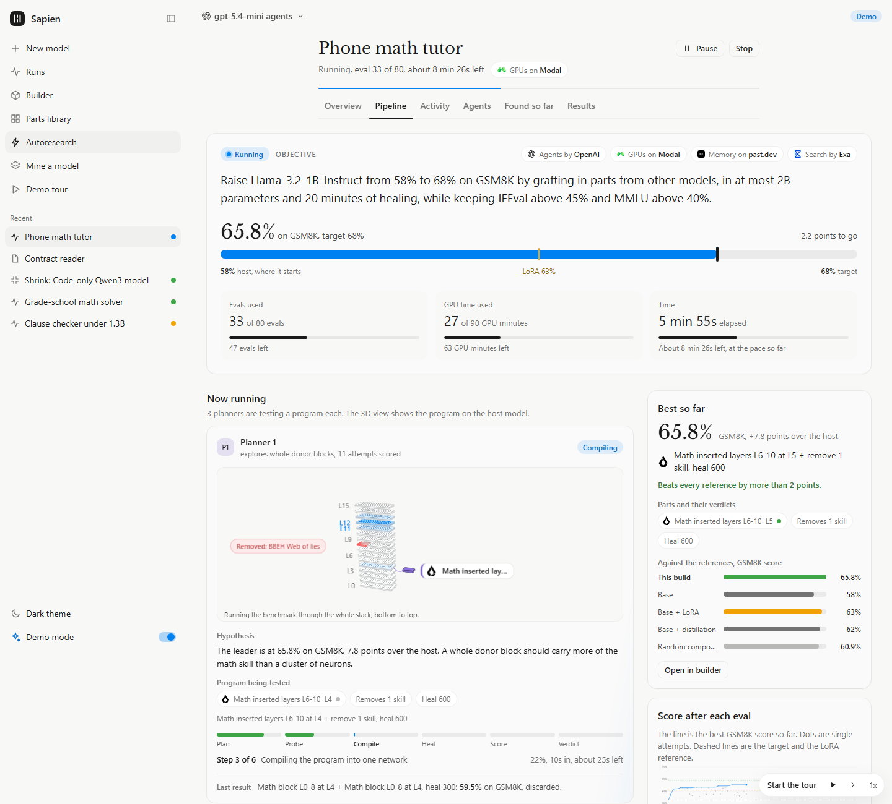
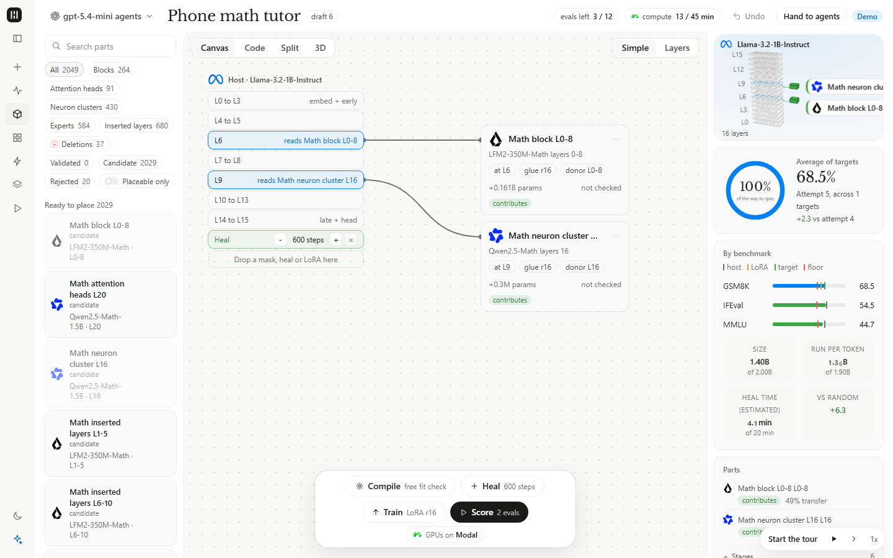
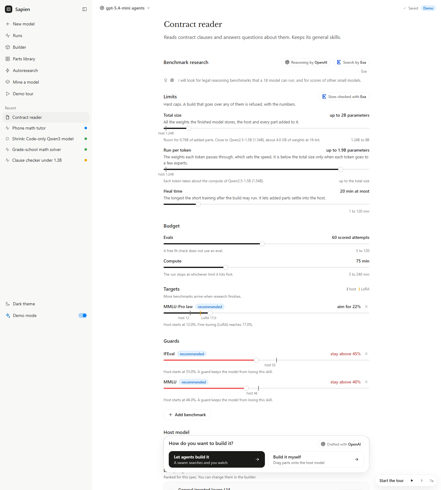
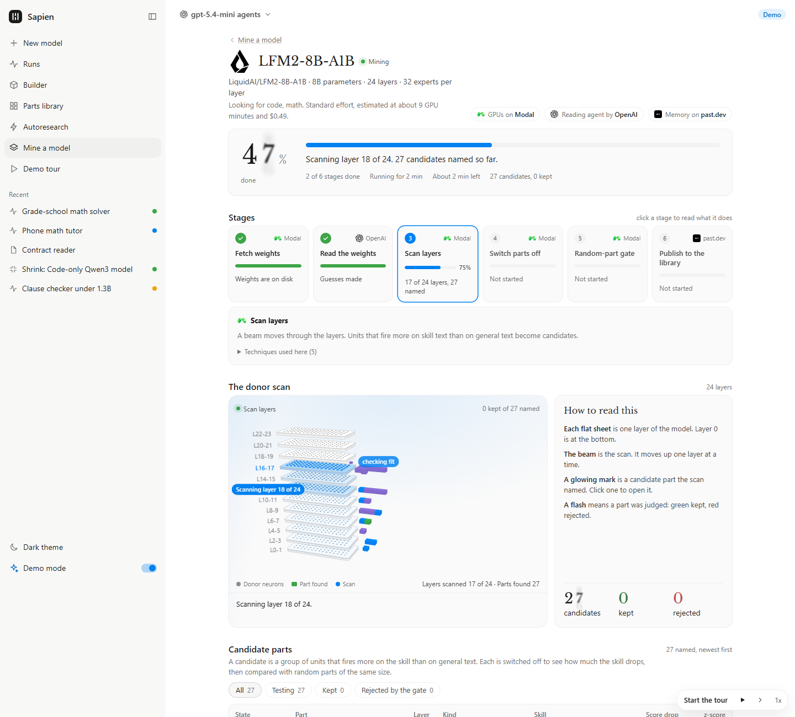
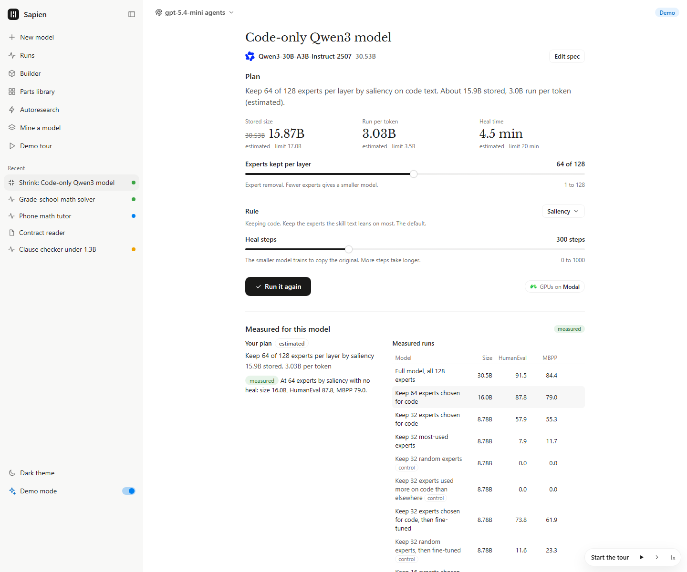
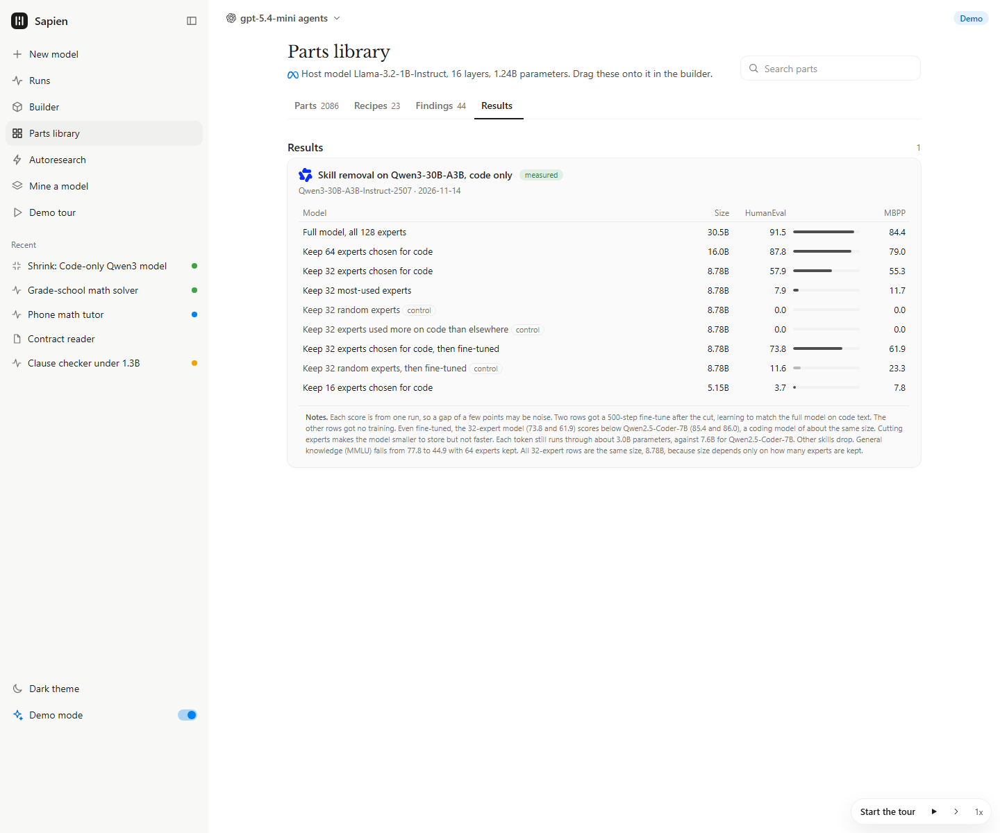

# Sapien

Sapien builds custom models from the parts of existing open models. Agents read the weights of open models and file the pieces that hold a skill into a parts library. A compiler then joins those parts into a base model, or cuts a large model down to the parts one skill needs, and trains only small connectors at the seams. Grafting a slice of Qwen2.5-14B into Llama-3.2-1B lifts its MMLU score from 44.6 to 59.8, where fine-tuning with the same trainable budget reaches 45.6. Cutting Qwen3-30B-A3B to half its experts keeps its HumanEval score within 4 points at half the memory.

Built at the SF AI Research Hackathon (Iterate, Wefunder office, 14 to 15 November 2026).

Sponsor challenges entered: Exa, past.dev and Modal.

<p>
  <a href="https://exa.ai"></a>
  <a href="https://past.dev"></a>
  <a href="https://modal.com"></a>
  <a href="https://iterate.inc"></a>
</p>

- Repo: [trisanths/wsp](https://github.com/trisanths/wsp)
- Results log with every run and its controls: [results/README.md](results/README.md)
- Parts library: [library/](library/) (1,606 entries across 76 models)

## Motivation

Fine-tuning changes every weight of one model to teach it a skill that some other open model already has. Thousands of open-weight models exist, and each one stores its skills in units you can find: specific MoE experts handle code tokens, specific layers carry factual recall, specific heads move information across positions. Lu et al. trained only a deletion mask over a model's existing weights and beat full fine-tuning on MMLU-Pro (18.6 against 17.0 at 1B), and their RL masks delete under 0.05% of parameters. That means a skill can be written by choosing which weights exist ([The Surprising Effectiveness of Deleting Weights in LLM Post-Training, 2026](https://arxiv.org/abs/2611.10866)). Sapien takes that idea from one model to many: treat the units of every open model as a parts library, and write a new model as a program over those parts.

That raises four research questions, which the team built in parallel:

1. **Grafting.** Can a slice of a large model, added to a small one, make the small model better than fine-tuning it?
2. **Mining.** Can agents find parts that hold a measurable skill in any model, at any size, with controls that rule out noise?
3. **Compiling.** Can parts from a different model family, with a different tokenizer, run inside a host and keep working?
4. **Shrinking.** Can a frontier model compress an open-source model by reading its weights: find the parts that hold one skill, delete the rest, and keep that skill at a fraction of the size?

An agent swarm ties the four together: it proposes builds, scores them against controls at a fixed evaluation budget, and shares what it learns through past.dev.

## What it does

Sapien turns a plain-language request ("a coding model at half the memory", "a 2B model that reads contracts") into one model built from the parts of existing models. Six stages get it there:

1. **Mine.** Agents read the weights of open models and name candidate parts: groups of neurons, attention heads, MoE experts or whole layers that seem to hold a skill.
2. **Test and file.** Each candidate is switched off and scored on every skill. It is kept only if switching it off hurts its own skill more than switching off any of five random parts of the same size, and leaves the other skills mostly intact. Kept parts go into the library with their scores.
3. **Plan.** Sapien drafts a spec from the request: a size limit, target benchmarks (found by an Exa research agent, with sourced reference scores), and guard skills the model must keep.
4. **Compile.** An agent swarm, or a person on a canvas, picks parts. The compiler adds them to a base model, removes parts it does not need, and trains a small connector at each seam.
5. **Heal.** A short training pass (LoRA or distillation from the original) lets the new parts settle.
6. **Evaluate.** The result is scored against the base model, a LoRA, the same build with random parts, and the best existing open model of the same size. The scores and the lessons go back to the swarm and into shared memory for the next attempt.

The output is one standard model that loads in Hugging Face Transformers and serves on vLLM, with no extra models running beside it.

## Architecture



## Screenshots

The Sapien studio is the web app over the whole pipeline. These captures use demo mode, which runs the app on sample runs in the browser; the measured results table and the shrink table show real numbers from the results log.

| | |
|---|---|
|  Autoresearch view: the objective, progress to target, and eval and GPU budget used |  Builder: parts from the library placed on Llama-3.2-1B, with scores against the spec |
|  Spec: Exa benchmark research, size limits, targets and guards |  Mining LFM2-8B-A1B: stages, the layer scan and candidate parts |
|  Shrink: keep 64 of 128 experts in Qwen3-30B-A3B, with measured runs and controls |  Library results: skill removal on Qwen3-30B-A3B |

More captures: [request](docs/img/studio-request.png), [agent activity](docs/img/studio-activity.png), [leaderboard](docs/img/studio-leaderboard.png), [model skill map](docs/img/studio-model-map.png), [parts library](docs/img/studio-library.png).

## Results

### 1. Grafting beats fine-tuning on every domain we tested

A frozen slice of a larger model, grafted into Llama-3.2-1B-Instruct, beats a LoRA with the same number of trainable parameters on every domain below. Each row trains on that domain's train split and scores on its held-out items. "Adapter only" is the same trainable connector with the donor slice removed, so it measures what the connector adds on its own; the graft's lead over it is what the donor model contributes.

| Domain | Base | LoRA | Adapter only | Graft | Donor |
|---|---|---|---|---|---|
| Math (AQuA) | 25.5 | 34.5 | 39.0 | **52.0** | Qwen2.5-Math-7B |
| Medicine (HEAD-QA) | 45.8 | 51.7 | 42.8 | **54.8** | Apollo2-7B |
| Medicine (MedMCQA) | 41.4 | 39.7 | 37.8 | **45.1** | Apollo2-7B |
| Science (SciQ) | 85.8 | 87.5 | 88.2 | **89.8** | Qwen2.5-7B |
| MMLU | 44.6 | 47.1 | 45.6 | **53.1** | Qwen2.5-7B |

The gain grows with the donor and carries to subjects the training never touches. These grafts train on answer letters from CommonsenseQA, OpenBookQA, QASC and LogiQA2.0, and never see MMLU:

| Host | Arm | MMLU held-out (2,000 items) | Seeds |
|---|---|---|---|
| Llama-3.2-1B | Base | 44.6 | |
| Llama-3.2-1B | LoRA, same trainable budget | 45.1 to 47.1 | 4 |
| Llama-3.2-1B | + Qwen2.5-7B layers 4 to 20 | 52.8 to 54.4 | 3 |
| Llama-3.2-1B | + Qwen2.5-14B layers 7 to 34 | 58.9, 61.0, 59.6 | 3 |
| Llama-3.2-1B | + Qwen2.5-32B layers 9 to 54 | 62.6 | 1 |
| Llama-3.2-3B | Base | 57.4 | |
| Llama-3.2-3B | LoRA, same trainable budget | 60.7 to 61.0 | 3 |
| Llama-3.2-3B | + Qwen2.5-32B layers 9 to 45 | 66.3 | 1 |

A 7B donor adds 8 to 10 MMLU points to the 1B host, a 14B donor adds 14 to 16, and a 32B donor adds 18. Trained only on commonsense and logic items, the 7B graft lifts MMLU medical subjects by 12 points over LoRA. Two specialists fit in one network: Qwen2.5-7B and Apollo2-7B grafted into the same 1B host reach 55.4 on MMLU held-out. The comparison holds trainable parameters equal; the grafted network also runs the frozen donor layers, so it stores more weights than the host. Source: [docs/research/2026-11-15-parallel-graft.md](docs/research/2026-11-15-parallel-graft.md).

With more training data and the donor's own answers as a target, the same 7B graft goes further. These runs train every arm on 44,155 four-option items (MMLU auxiliary_train plus the CommonsenseQA, OpenBookQA, QASC and LogiQA train splits, every eval prompt removed), with distillation from the donor's answer distribution and a rank-16 LoRA on the host trained with the graft. Every fine-tuning arm, including a full fine-tune of all host weights, gets the same data, steps and selection rule:

| Host | Arm | MMLU held-out (2,000) | ARC-Challenge test | Params per token | Seeds |
|---|---|---|---|---|---|
| Llama-3.2-1B | Base | 44.6 | 55.3 | 1.24B | |
| Llama-3.2-1B | Full fine-tune | 51.1 | 69.5 | 1.24B | 3 |
| Llama-3.2-1B | LoRA rank 128 | 50.0 | 69.4 | 1.24B | 3 |
| Llama-3.2-1B | Same connector, donor weights scrambled | 50.3 | 69.2 | 5.21B | 3 |
| Llama-3.2-1B | + Qwen2.5-7B layers 4 to 20 | **59.6** (59.5, 60.4, 58.9) | **85.3** | 5.21B | 3 |
| Qwen2.5-1.5B | Base | 60.4 | 77.6 | 1.54B | |
| Qwen2.5-1.5B | Full fine-tune | 60.6, 61.0 | 79.7, 79.4 | 1.54B | 2 |
| Qwen2.5-1.5B | LoRA rank 128 | 62.5, 61.3 | 80.5, 80.2 | 1.69B | 2 |
| Qwen2.5-1.5B | Same connector, donor weights scrambled | 60.8, 60.8 | 80.6, 80.0 | 11.7B | 2 |
| Qwen2.5-1.5B | + Qwen2.5-14B layers 14 to 47 | **66.1, 65.7** | **85.7, 85.2** | 11.7B | 2 |

The 7B donor now reaches the score the commonsense-only runs needed a 14B donor for, and the graft beats a full fine-tune of the host by 8.5 points. A scrambled donor slice (same weight spectrum, no knowledge) scores like the fine-tuning arms, so the gain is the donor's knowledge. The grafted network runs more parameters per token than the host: at that cost, native Qwen2.5-3B-Instruct scores 66.0 in the same harness (66.6 after the same fine-tune), so a host that is already the best at its size is the next test. Sources: [docs/write_in_xfam.md](docs/write_in_xfam.md), [docs/write_in_bigsame.md](docs/write_in_bigsame.md).

Math works the same way. Qwen2.5-1.5B-Instruct gets a frozen slice of Qwen2.5-Math-7B-Instruct (layers 4 to 20, read after host layer 14). Every arm trains on 25,590 verified solutions the donor wrote to GSM8K and MATH train problems, with distillation from the donor's logits:

| Arm | GSM8K test (500) | MATH-500 | MMLU (guard) |
|---|---|---|---|
| Base | 73.6 | 54.0 | 58.8 |
| Full fine-tune | 69.4, 71.4 | 52.0, 52.8 | 58.5, 58.9 |
| LoRA rank 128 | 72.8, 74.2 | 51.6, 49.6 | 59.6, 59.2 |
| Same connector, donor weights scrambled | 73.2, 73.2 | 54.4, 54.6 | 59.2, 58.8 |
| + Qwen2.5-Math-7B layers 4 to 20 | **85.8, 83.8** | **59.6, 58.0** | 59.6, 59.0 |
| Qwen2.5-Math-7B alone | 92.2 | 76.8 | 52.6 |

Fine-tuning on the donor's solutions does not raise any fine-tuning arm above the base, while the graft gains 10 to 12 GSM8K points and keeps MMLU. Source: [docs/write_in_math_rl.md](docs/write_in_math_rl.md).

### 2. Mining: agents went from Roman numerals to math, science and medicine

Mining agents started on skills small enough to check exactly: Roman numerals, compass directions, the next month or weekday, ordinal words. Switching off one MLP cluster in layer 25 of LFM2.5-2.6B dropped its Roman-numeral score by 0.372 while its matched control moved by 0.001. Each attempt, pass or fail, went to past.dev as one sentence with its numbers, so an agent mining Gemma could read what another agent had found in Qwen.

Shared memory made the agents faster at finding working tests. After a prompt change that had each agent recall from past.dev before writing a new skill test, recall use went from 0 to 1 call per agent within three minutes, and each recall returned 11 to 14 relevant records; the agent mining Phi-4 found a teammate's integer-parity test and a matching Gemma part before writing its own. With those lessons in shared memory, the agents moved from toy skills to domain skills.

The library now holds parts for:

| Skill area | Parts |
|---|---|
| Math (including grade-school arithmetic) | 659 |
| Programming languages (Java, Rust, C#, TypeScript, PHP, Swift, C++, SQL, shell and more) | about 20 each |
| Science and professional subjects (chemistry, physics, biology, medicine, clinical knowledge, law, finance) | 17 to 21 each |
| Natural languages (Chinese, Hindi, Russian, French, Japanese, Arabic, Spanish) | 18 to 20 each |
| Tool calling and instruction following | 19 to 20 each |

Qwen2.5-Math-7B alone gave 63 math parts. Gemma-4-26B-A4B gave expert sets that each write output in one language (Russian, German, Chinese, French, Italian, Japanese, Spanish) in layers 20 to 29. In all, 1,606 library entries cover 76 models from 0.35B to 235B parameters.

### 3. Compiling: a part from another model family keeps 90% of its skill inside the host

The hard part of grafting is translation. The host and donor come from different companies, use different tokenizers, and represent text in different hidden spaces, so a donor slice fed the host's raw states produces noise. The compiler fixes this in three steps.

1. **Align.** A small encoder learns to turn the host's hidden states into the states the donor slice expects. It trains by making the donor's next-token predictions on host states match the donor's own predictions on the same text, with positions paired across the two tokenizers by character offsets. Before alignment, Qwen2.5-7B keeps 1.1% of its next-token accuracy when it runs on Llama's states. After 600 training steps (about 2 minutes on an H100) it keeps 89.6%.
2. **Glue.** A decoder reads what the donor slice changed and writes it back into the host, and a per-token gate decides how much to let through. Both start at zero, so the network starts as the exact host. The gate learns to open on domain text (an update of 0.12 to 0.35 times the hidden state's size) and stay nearly shut on general text (0.02 to 0.04).
3. **Heal.** A short training pass on answer letters teaches the host to use the new branch, with a penalty for drifting from the original host. On law text, which no graft trains on, the grafted model drifts less from the base than LoRA does (KL 0.01 against 0.03 to 0.06).

When donor and host share a tokenizer, the connector is close to lossless: a Qwen donor block inside a Qwen base computes what it computes in its own model, at a cost of 0.008 nats.

### 4. Shrinking: removing experts keeps one skill and drops the rest

Qwen3-30B-A3B has 128 experts in each layer. Each layer keeps its top N experts by code saliency: how strongly the router picks an expert on code text, times how much that expert changes the output. The text used to rank and heal is code instructions, never benchmark items.

| Model | Total params | HumanEval | MBPP | MMLU |
|---|---|---|---|---|
| Full Qwen3-30B-A3B | 30.5B | 91.5 | 84.4 | 77.8 |
| Keep 64 experts by code saliency, no training | 16.0B | 87.8 | 79.0 | 44.9 |
| Keep 32 by code saliency, healed | 8.78B | 73.8 | 61.9 | 25.6 |
| Keep 32 random experts, healed (3 seeds) | 8.78B | 6.1 to 11.6 | 7.4 to 23.3 | 24 |

Half the experts keep HumanEval within 4 points with no training, while MMLU falls 33 points: the other skills leave with the deleted experts. Random experts of the same count lose code entirely, so the choice of experts carries the skill.

Served on vLLM 0.32 on one H200, the 64-expert model halves weight memory, solves 145 of the 148 HumanEval items the full model solves, and decodes 21% faster at batch 32:

| Model | vLLM weight memory | HumanEval (164) | Decode tok/s, batch 1 / 32 |
|---|---|---|---|
| Full Qwen3-30B-A3B | 56.93 GiB | 90.2 | 259 / 2486 |
| Keep 64 experts | 29.92 GiB | 88.4 | 259 / 3021 |

Quantization and speculative decoding stack on top. All rows are vLLM 0.32, greedy, one run each; HumanEval moves about 2 points between configs with the same weights ([docs/efficiency.md](docs/efficiency.md)):

| Model | GPU | Weight memory | HumanEval | MBPP | Decode tok/s, batch 1 / 32 |
|---|---|---|---|---|---|
| Full, INT4 (GPTQ) | A10G 24 GB | 15.7 GiB | 90.2 | 84.4 | 133 / 1107 |
| Full, INT4, EAGLE-3 draft head | A10G 24 GB | 16.0 GiB | 92.1 | 84.4 | 219 / 1452 |
| Full, bf16, EAGLE-3 draft head | H200 | 57.3 GiB | 90.2 | 84.4 | 467 / 4679 |
| Full, INT4, EAGLE-3 with 7 draft tokens | H200 | 16.0 GiB | 90.9 | 85.2 | 556 / 5873 |
| Keep 64 experts, INT4 | H200 | 8.7 GiB | 89.0 | 81.3 | 217 / 4208 |
| Keep 64 experts, INT4 | L4 24 GB | 8.7 GiB | 87.2 | 82.9 | 89 / 800 |

The full model in INT4 fits a 24 GB card with no HumanEval loss, and EAGLE-3 roughly doubles batch-1 speed at the same accuracy (539 against 234 tok/s on real HumanEval requests in bf16, 778 in INT4 with 7 draft tokens). The 64-expert model in INT4 is 8.7 GiB.

Verified self-training lifts the 32-expert model. One round samples 10,594 train problems with tests (MBPP train, validation and prompt splits, LeetCodeDataset, APPS and AceCode-87K, with any problem that shares a 13-gram with a HumanEval or MBPP test item dropped), keeps the answers that pass their tests, adds passing answers from the full 30B model, and trains on them. Under vLLM it moves the healed 8.78B model from 82.9 to 83.5 on HumanEval and from 73.2 to 77.0 on MBPP, against 90.9 and 83.7 for the full model in the same harness (one seed; the HumanEval change is inside the noise) ([docs/rft.md](docs/rft.md)).

The same method works at 235B. On Qwen3-235B-A22B-Instruct-2507 (8 H200s, no training), keeping 64 of 128 experts cuts the model from 235.1B to 121.5B parameters and scores 92.7 HumanEval and 87.2 MBPP, against 93.3 and 87.5 for the full model ([docs/moonshot.md](docs/moonshot.md)).

## How we built it

### Mining (`person_a/mine/`)

For one donor model, a mining agent (Claude Opus 5.5 or GPT-5 through a tool loop, `agent.py`) does four things:

1. Reads the raw weights in a network-blocked, read-only Modal sandbox (`weight_sandbox.py`).
2. Proposes open-vocabulary skill labels (Roman numerals, month successor, per-language output experts).
3. Writes frozen tests for each label, with a matched control text and a chance check (`skills.py`).
4. Screens candidate parts by zero-ablation on a Modal GPU. Every ablation scores all active skills in one teacher-forced pass, as the mean log-prob of the answer tokens.

`adapter.py` installs one zero-ablation hook per part kind: zero the MLP down-projection columns, zero a head's slice of the attention out-projection (also Gated DeltaNet layers), set banned experts' routing weights to 0 at the fused-experts input, or replace a layer's output with its input.

A part passes the light gate (`gate_version` 2) only if:

- the target skill drops at least 15% relative on both the search half and a held-out half the agent sees only as pass or fail;
- every other skill drops by at most max(5%, target drop / 3);
- the target's matched control moves by at most the same limit in either direction;
- the target drop beats each of 5 random parts of the same size and kind in the same layer.

`sweep.py` ranks every unit of every layer by attribution with no LLM in the loop, and `maps.py` builds model-level skill maps (layer scores, blocks, expert pick rates). The Qwen3-30B-A3B map covers 48 layers and 38 skills with a median split-half correlation of 0.98.

The library now holds 584 expert sets, 430 MLP clusters, 264 blocks, 91 head groups, 58 measured stitch recipes, 37 deletion masks, 44 findings and 23 run recipes across 76 models from 0.35B to 235B parameters (Qwen, Llama, Gemma, LFM, Phi, Granite and domain fine-tunes).

### Compiler (`wsp/`)

Before building anything, the compiler works out how each source model relates to the base: identical, a fine-tune of the same base, the same tokenizer, or a different family (`wsp/lineage.py`). It decides this from small reads of each model's config, tokenizer and a few weight slices, with no full download. The relation sets which build methods are allowed, and the planner (`wsp/auto.py`) takes the first one that fits the size limits.

A part from another model joins the base as a side branch at a chosen layer. A small connector maps the base model's hidden state into the part's space and back, and starts at zero, so a fresh part changes nothing until training. Parts keep their own attention cache, so generation with a cache gives the same output as without. Two fixes made cross-model parts work at all: feeding each part the state its own model expects at the first token (its attention sink), and scaling inputs to the size the part saw in its own model.

`wsp/slim.py` removes experts, layers, neurons or heads and runs the distillation heal. `sapien check` estimates the finished size against the limits before any GPU starts.

### Swarm and studio (`wsp/swarm/`, `studio/`)

The swarm is an RL-style environment: planner agents propose programs over the library, a judge ranks them each round, and an analyst keeps a capability map. Each evaluation charges a fixed budget, and baselines (evolutionary search, LoRA, full fine-tune) run at the same budget. `wsp/swarm/program_schema.py` validates every proposal before it costs an eval.

The Sapien studio is a FastAPI app over the compiler and swarm. A person describes a model in plain language, the studio drafts a spec, a research agent proposes benchmarks with sourced reference scores, and then either the swarm builds the model or the person places parts on a canvas. On the Modal backend each call compiles one program, trains its stitch and heal, scores it, and returns per-component verdicts in one GPU container.

## Sponsor challenges

###  Exa: research agents that search

Exa runs in two loops.

**Benchmark research** (`studio/server/bench_research.py`, lines 672 and 1029). Every spec draft starts a research agent that plans searches, picks 3 to 6 benchmarks that fit the request, then searches each benchmark's published results and extracts reference scores for models within the size limit. A checker opens each cited page with Exa get-contents and keeps a score only when the number appears on the page for that benchmark and that model. The spec page shows every query, source URL and quote.

We graded it on 8 requests (legal, coding, nursing, math tutoring, telecom support, English-Spanish, a coding-only shrink, general reasoning) by opening every source page by hand ([docs/research/bench_research_eval.md](docs/research/bench_research_eval.md)). Before the fixes, 29 of 59 checked scores (49%) were fully right; the common failures were the right number from the wrong column or the wrong model. After the fixes, 24 of 24 sourced scores were right. The agent picked domain benchmarks a model would not list from memory, such as tau-bench telecom and CaseHOLD.

**Literature priors for the swarm** (`wsp/swarm/literature.py`). Planners read Exa search results as priors before proposing programs. Every call goes through one module with a content-addressed cache: the key is the sha256 of the endpoint, SDK version and exact parameters, and the cache is git-tracked in `exa_cache/` so graded runs replay with zero network calls. A second cache tier on a `modal.Dict` lets parallel containers share hits. Queries are capped at 400 characters, dataset mirror domains are excluded, the published-date filter is pinned, and Exa never sees held-out data or touches the eval budget.

###  past.dev: shared memory for agent swarms

past.dev is the team's shared memory and the swarm's memory, under two separate scoping rules.

**Team memory** (`person_a/mine/shared_memory.py`, `scripts/team_memory.py`). Every person and every coding agent on the team recalls before a task and records after each decision or result, in the audience `wsp-mining`. Mining agents write each part attempt, gate verdict and failure, so an agent mining Gemma reads what another agent found in Qwen. The client refuses writes outside that audience.

**Run-scoped swarm memory** (`wsp/swarm/memory.py`). A benchmark run must read only what it wrote, or the eval budget comparison is unfair. Each run gets fixed audiences (`<run>-lessons` for planners, judge and analyst; `<run>-judge` for the judge alone) and per-run identities. Before the first step, a cold-start guard recalls as a planner with a generic query and requires zero results, which proves no project-level leakage. Ids embed the run id, and at the end of the run all data points are deleted in batches of up to 1,000 and the audiences removed. Records are one self-contained sentence with the score in it, for example a collapse lesson: which deletion dropped instruction following from 0.61 to 0.02. The planned ablation is the same swarm with `PAST_ENABLED=false` at equal eval budget.

An audit of Rex's mining runs (qwen3.8_27b, gemma4_31b, phi4_14b) found every write landed with no dropped batches, but the agents made 0 `recall_shared` calls during runs: they read team memory once at startup, with a query that named the architecture and not the model, and about 2 in 3 attempt records were ablation-only probes that crowded recalls. That finding changed how the agent queries memory.

###  Modal: training, inference and large-scale experiments

Every GPU step runs on Modal: mining, compiling, healing, scoring and serving.

- **Mining engine** (`person_a/mine/engine_app.py`). Deployed classes `EngineL4` through `EngineB200x8`, one per GPU tier, share one `EngineBase`. The client picks the tier from model size. Weights live on a shared volume at a pinned snapshot, and the agent's weight-reading sandbox has no network access.
- **Parallel mining**. Twelve Claude Opus 5.5 mining agents ran at once across three Modal workspaces on the first night, alongside skill-map jobs for Qwen2.5-32B, Qwen3-30B-A3B and Qwen3.5-35B-A3B, until all three workspaces hit the 10-container GPU limit and mining paused for the compiler's rounds.
- **Compiler rounds** (`modal_round*.py`, 28 rounds). Each round sweeps cells with seeds and controls in parallel containers. Run 2 alone was 72 cells.
- **Studio backend** (`studio/modal_studio.py`). The `wsp-studio` app compiles, heals and scores one program per call on L40S, or H100 when a donor is above about 10B parameters.
- **Serving** (`modal_serve.py`). vLLM 0.32 on H200 measures weight memory, decode and prefill throughput and time to first token for each slimmed model, and the 235B run used 8 H200s.

## Track 1: autoresearch

Sapien runs the research loop on model construction. A mining agent picks a hypothesis about a donor (a label and a layer), writes a frozen test, runs the ablation on Modal, reads the gate result against random controls, records it to past.dev, and picks the next hypothesis. The swarm does the same over programs: propose, compile, score at a fixed eval budget, rank, record lessons, propose again.

The record Sapien targets is the best existing open model at the same size. That bar is in every comparison table above, and the compiler's latest change checks each graft plan against it before spending GPU time. The 1B host with a grafted 14B slice reaches 59.8 on MMLU held-out (three-seed mean), against 45.6 for fine-tuning the same host.

Each decision is logged: `experiments.jsonl` for swarm steps, `results/README.md` for every run with its controls and reading, `library/index.jsonl` with `added_by`, `source` and evidence on every entry, and the past.dev audiences for the reasoning between steps.

## Challenges we ran into

- **The stitch was the bottleneck.** Rounds 1 to 3 grafted Qwen-Math parts into Llama and nothing beat a random part. Round 4 moved to a Qwen host with the same tokenizer to separate "the stitch is lossy" from "tokenization differs". The answer was both: a same-tokenizer stitch trained on the donor's LM loss is near-lossless, and a cross-tokenizer stitch closes at most half the gap.
- **A broken eval protocol.** The first GSM8K harness used a bare prompt with no chat template and a 256-token limit, which cut instruct models off before the final number. Five runs of conclusions rested on it. We found it on day two, measured the gap on the same 200 items, and marked every affected number in the log.
- **The attention sink.** An audit found grafted parts never saw the donor's position-0 state, so they ran off-distribution on every sequence. The fix records the donor's mean sink state at the part's input and feeds it at each sequence's first real token.
- **GPU memory and container limits.** phi4_14b in bf16 (about 29 GB) ran out of memory on a 44 GiB L40S during attribution scans, and every later call on the same container failed with CUDA out of memory, so the run made no progress until we moved it to an H100. Three workspaces at the 10-container GPU limit forced a schedule between mining and compiling.
- **MoE prefill.** The slimmed 30B decodes 21% faster at batch 32 but prefills 38% slower. Both cells logged Triton fused-MoE JIT warnings, and vLLM used a tuned E=128 config for the full model and its default E=64 config for the slim one. Not resolved.

## What we learned

- MoE experts are the most separable unit in an open model. Removing them by saliency keeps one skill and deletes the others, with no training.
- The ranking decides the outcome. Saliency (route weight times write norm) holds code; routing frequency collapses it. Frequency measures how often an expert fires, saliency measures how much it changes the output.
- A heal recovers a damaged model and does not teach a skill. The heal control (full model, same heal) proves it.
- Every component needs a control of the same size with the donor removed. Without one, the gain from adapter parameters looks like transferred skill.
- Shared memory needs scoping before it needs volume. A swarm that can read a previous run's lessons is no longer a fair benchmark.

## What's next

- Fix the 38% MoE prefill gap with a tuned vLLM config for each expert count, then remeasure throughput.
- Heal the keep-64 model for the planned 30 minutes and test whether it clears the native-coder bar.
- Compose expert sets across MoE models of the same family: the library already holds per-language output experts for seven languages in Gemma-4-26B-A4B layers 20 to 29.
- Run the swarm with and without past.dev memory at equal eval budget and report the difference.
- Make agents recall per model during mining, not once per run.

## Team

- **Trisanth** set research direction and built the language and compiler (`wsp/`), the lineage classifier and front door (`wsp/auto.py`), expert removal (`wsp/slim.py`), the atlas skill maps, most of the 28 Modal rounds, and the 235B run.
- **Hanav** built the parts-mining pipeline (`person_a/mine/`): the Modal engine tiers, the ablation adapter, the light gate and the catalog export.
- **Arjun** built the swarm environment (`wsp/swarm/`) on his agent-swarm infrastructure: planners, judge, budget, baselines and the program schema.
- **Rex** ran mining on qwen3.8_27b, gemma4_31b and phi4_14b, led the Exa and past.dev integrations (`docs/research/exa.md`, `docs/research/pastdev.md`), and audited the agents' use of shared memory.

## Run it

The full language and compiler reference (every graft option, the mask format, Modal profiles) is in [docs/wsp-reference.md](docs/wsp-reference.md).

CPU tests (toy tensors, no model downloads):

```bash
uv venv --python 3.12 && uv pip install -e ".[dev]" && .venv/bin/pytest -q
```

Plan a request with no GPU and no weights, then build it:

```bash
sapien plan demo/requests/code_half_memory.json
modal run modal_sapien.py --request demo/requests/code_half_memory.json
```

Write and compile a program directly:

```bash
sapien check prog.sap
sapien compile prog.sap -o out
sapien compile prog.sap -o ctl --control random
sapien score out --skills humaneval,mbpp,mmlu
```

Studio (stub backend, or `WSP_STUDIO_BACKEND=modal` after `modal deploy studio/modal_studio.py`):

```bash
pip install -e ".[dev,swarm,studio]" && uvicorn studio.server.app:app --port 8765
```

`EXA_API_KEY`, `PAST_API_KEY`, `OPENAI_API_KEY` or `ANTHROPIC_API_KEY`, and Modal tokens are read from `.env`.

## Built with

Python, PyTorch, Hugging Face Transformers 5, safetensors, vLLM, Modal, Exa (`exa-py`), past.dev, FastAPI, Claude Opus 5.5, GPT-5, LoRA, Deletion Tuning masks, and open-weight models from Qwen, Meta Llama, Google Gemma, Liquid AI, Microsoft Phi and IBM Granite.

## License

Deletion Tuning mask code is from agentic-learning-ai-lab/deleting-weights (MIT). Each mined part keeps the license of its source model, recorded in its library profile.
